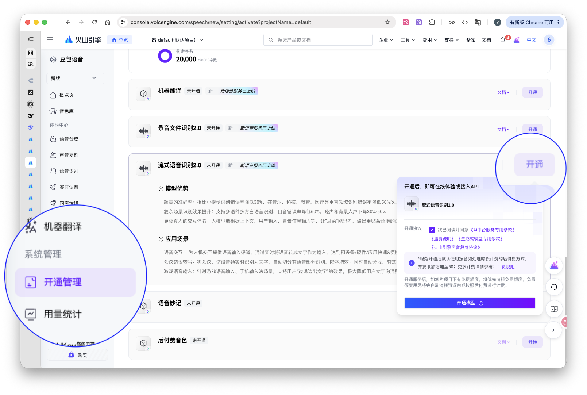
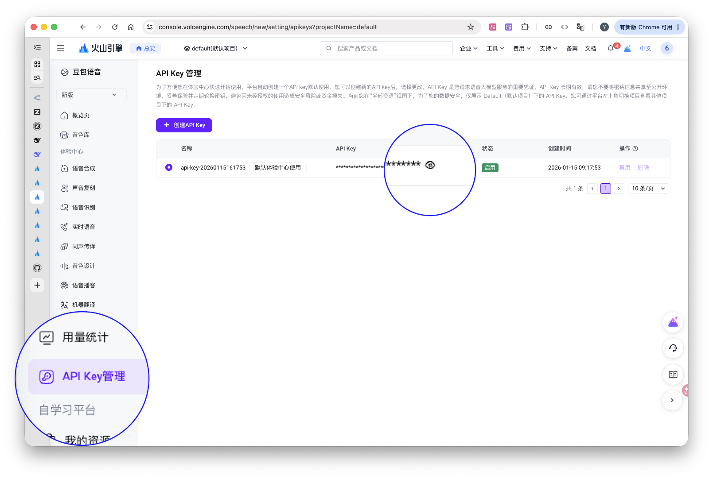
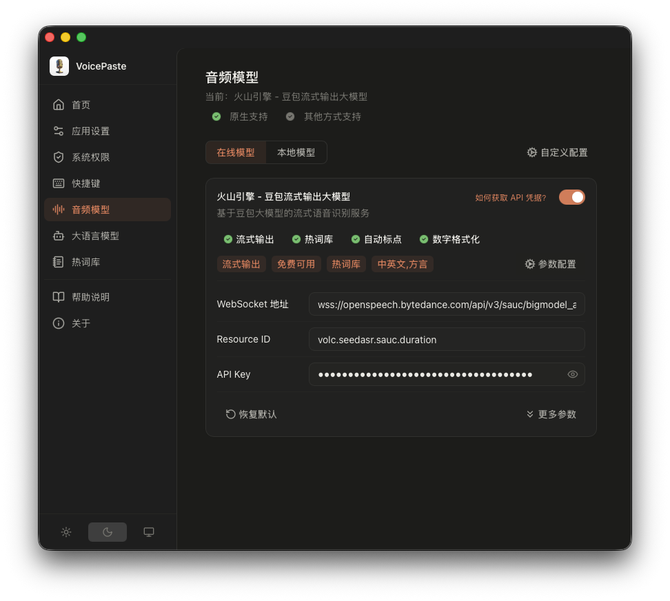
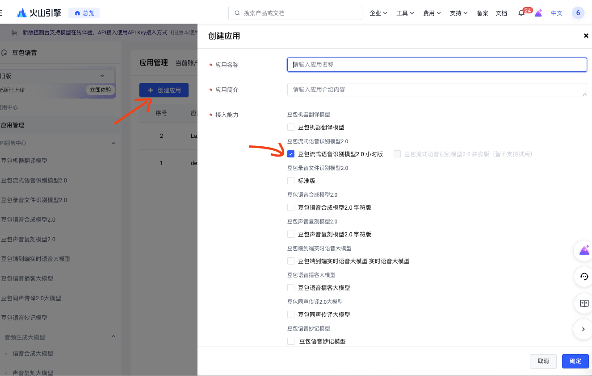
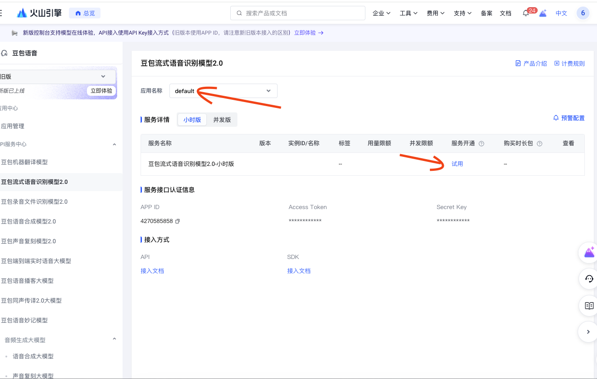
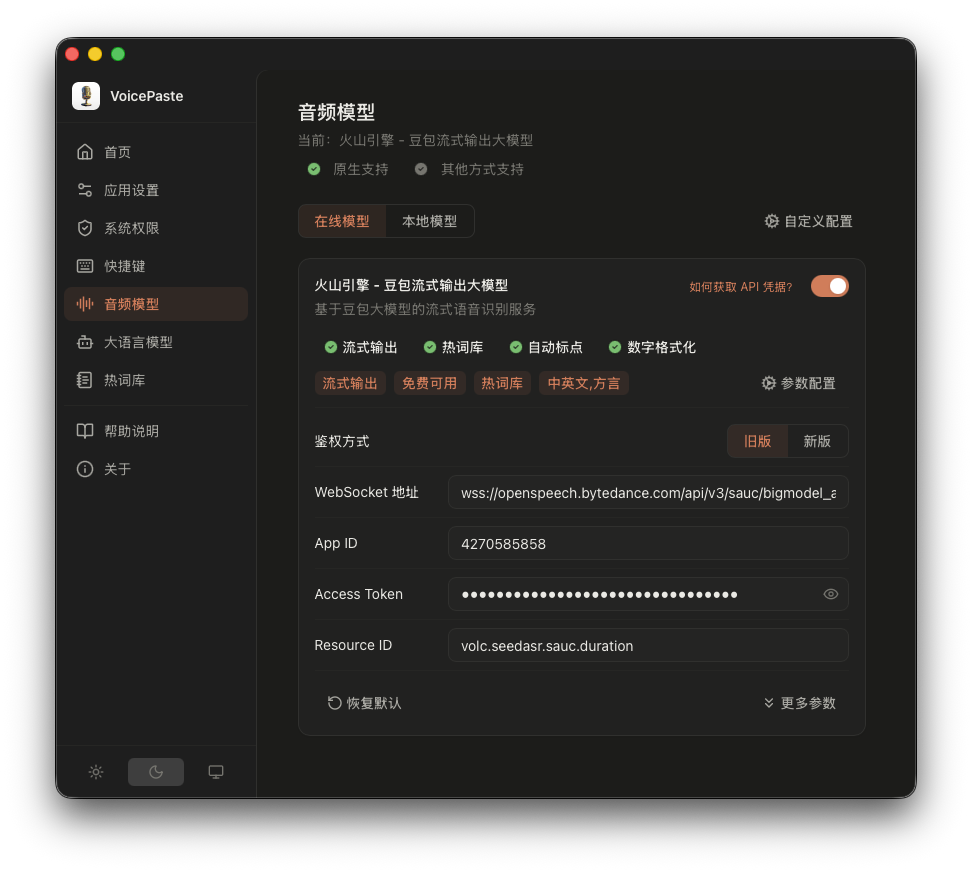

# VoicePaste Configuration Guide

For current setup and troubleshooting, see the official [documentation](https://voicepaste.dev/en/docs) and [FAQ](https://voicepaste.dev/en/docs/faq).

## Quick Start

- Settings > General settings > Permissions — enable Microphone and Accessibility permissions (macOS only)
- Settings > Speech models — configure an ASR model: online models require an API Key, local models require download and activation
- Settings > Hotkeys — view your current shortcuts or customize them as needed

## System Permissions

- The system will request Microphone permission the first time you use voice input
- macOS requires manually adding Accessibility permission to enable auto-paste after voice input. Go to Settings > General settings > Permissions > Accessibility > Grant Access to add VoicePaste to the allow list; or directly add it via System Settings > Privacy & Security > Accessibility.

## ASR Model Selection

- Settings > Speech models — choose an online model (see [Volcengine (Doubao)](#volcengine) or [ElevenLabs — Scribe v2 Realtime](#elevenlabs)) or a local model (see [Local Models](#local-models))

## Hotkey Configuration

Go to **Settings > Hotkeys** to choose how to use voice input and each polishing template:

- **Toggle**: press the global wake key to start recording, then the corresponding stop key to finish. Voice input defaults to pressing the global key again to stop; using a polishing template's stop key also polishes the recognized text.
- **Hold**: hold the corresponding hotkey for **0.5 seconds**, wait for the start cue before speaking, then release to finish.
- **Cancel recording**: press `ESC`. Nothing from this recording will be pasted.

If a shortcut conflict is reported when assigning hotkeys or switching modes, follow the prompt to choose another hotkey.

## Text Polishing Configuration

- Go to Settings > LLM, select and enable an LLM provider (only one active at a time)
- Add polishing templates under Text Polishing — you can add multiple templates
- Go to Settings > Hotkeys to bind a hotkey to each template

## Hotwords Configuration

- Manage hotwords under Settings > Hotwords
- Multiple hotword groups are supported; only one group is active at a time — switch manually as needed
- Batch-add hotwords separated by `,` commas and press `↩︎` to confirm
- Hotwords support a weight parameter using the format `hotword|weight`, with weight ranging from 1–10 (defaults to 4)
- Hotwords take effect automatically for models with native hotword support: Doubao Streaming, Zipformer, FunASR-Nano, Qwen3-ASR; ElevenLabs — Scribe v2 Realtime also supports hotwords when its keyterm option is enabled
- **Hotword Boosting**: three modes available
  - **Auto**: use the model's native hotword capability if supported; otherwise, append hotwords to the polishing prompt if LLM text polishing is enabled; otherwise, do nothing
  - **Disabled**: do not append hotwords to polishing requests; the recognizer's own hotword support is unchanged
  - **Enabled**: always append hotwords when using a polishing template, even if the recognizer already supports them
- **Hotword Restoration**: after recognition, restore hotwords in the output to their original formatting (e.g., punctuation, capitalization). Model built-in hotword systems typically do not support special characters, and some models only accept uppercase English hotwords — enabling this feature automatically restores the original text format.

## Other Settings

- **Sound Effects**: App Settings > Sound Effects — enable/disable start and end sounds for voice input; supports custom audio files
- **Remove Trailing Period**: App Settings > Remove Trailing Period — automatically removes the trailing period from recognition results
- **Keep Clipboard**: App Settings > Keep Clipboard — keeps the result in the clipboard after automatic paste when enabled; restores the previous clipboard text when disabled
- **Beta Updates**: App Settings > Beta Updates — when enabled, receive beta version update notifications and upgrade to beta releases; you can continue upgrading to future stable releases (beta versions are for testing and may be unstable)

## Model Configuration

### Volcengine

#### API Credentials

**New Version**
- Log in to [Volcengine Console > Doubao Speech > Activation](https://console.volcengine.com/speech/new/setting/activate), find "Streaming Speech Recognition 2.0" and activate it. New projects receive 20 hours of free quota — refer to the official documentation for details and monitor your usage.

- Go to [Volcengine Console > API Key Management](https://console.volcengine.com/speech/new/setting/apikeys) to obtain or create an API Key

- Enter your credentials in the settings page and click Save

**Legacy Version**
- Log in to the [Volcengine Console](https://console.volcengine.com/speech/app), create an app, and select "Doubao Streaming ASR Model 2.0 (Hourly)"

- Open the model, select your app, and enable the model package. You will see the APP ID and Access Token below.

- Enter your credentials in the settings page and click Save

#### Hotwords

This model supports both online and local hotword tables.

- Online hotwords: go to [Volcengine Console > Doubao Speech > Hotword Management](https://console.volcengine.com/speech/new/hot-word) to configure. After setup, copy the hotword table ID and paste it into Settings > Speech models > Volcengine > Advanced Parameters > Hotword Table ID. See the [Volcengine Hotword Documentation](https://www.volcengine.com/docs/6561/155739) for details.
- Local hotwords: see the [Hotwords Configuration](#hotwords-configuration) section.

When both online and local hotword tables are present, priority is: local > online. You can also combine with LLM text polishing to boost hotword recognition — see [Text Polishing Configuration](#text-polishing-configuration).

#### Correction Table

Correction tables are online-only. Go to [Volcengine Console > Doubao Speech > Correction Words](https://console.volcengine.com/speech/new/correct-word) to create a correction table. After setup, copy the correction table ID and paste it into Settings > Speech models > Volcengine > Advanced Parameters > Correction Table ID.

See the [Volcengine Correction Table Documentation](https://www.volcengine.com/docs/6561/1206007) for details.

#### Advanced Parameter Tuning

Refer to the [Volcengine Streaming ASR API Documentation](https://www.volcengine.com/docs/6561/1354869).

### ElevenLabs

Use **ElevenLabs — Scribe v2 Realtime** for live speech recognition. See the [full setup guide](https://voicepaste.dev/en/docs/api/elevenlabs).

- Log in to [ElevenLabs > ElevenAPI > API Keys](https://elevenlabs.io/app/api/api-keys)
- Create an API Key and enable `Speech to Text` access

- In Settings > Speech models > Online Models, find ElevenLabs — Scribe v2 Realtime, enter your API key, save, and enable the model

### Local Models

VoicePaste local models are powered by sherpa-onnx, with VAD enabled by default and an optional Punctuation model for post-processing (adding punctuation marks).

#### Model Download

Settings > Speech models > Local Models — select and download the desired model (the matching VAD and Punctuation models are downloaded automatically). Once downloaded, simply enable it to start using.

#### Parameter Configuration

All model parameters are fully exposed for customization, though the defaults work well out of the box. For detailed configuration and model information, see the [sherpa-onnx Official Guide](https://k2-fsa.github.io/sherpa/onnx/index.html).

#### Custom Configuration

Settings > Speech models > Custom Config > Local Model Inference provides unified parameters for all local sherpa-onnx models.
