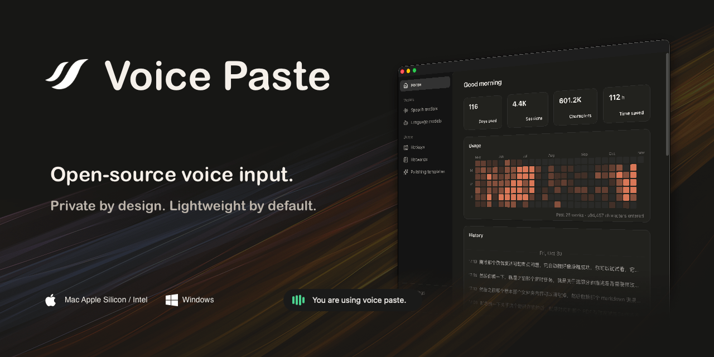
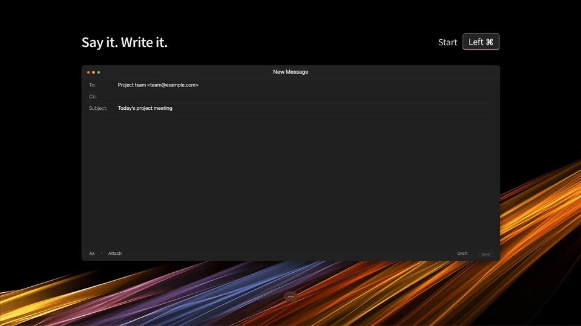

# VoicePaste

VoicePaste is a free, open-source, lightweight voice typing app for macOS and Windows.

**[Download](https://voicepaste.dev/en/downloads)** · **[Quick start](https://voicepaste.dev/en/docs)**

**[中文](README.zh.md)** | **[English](README.md)**

## Demo

## Features

- **Free and open source**: MIT-licensed. Use your own API keys for online services and pay providers directly, so you can check their pricing and your usage.
- **Lightweight**: The installer is about 20 MB, with around 120 MB of idle memory use on macOS. Recognition models load on demand; memory use varies by model and backend.
- **Online and local recognition**: Use an online service such as Doubao or ElevenLabs, or download a local model to transcribe offline without an API key. Local recognition keeps your audio on your device.
- **Flexible shortcuts and templates**: Set your preferred shortcuts. In toggle mode, speak first, then choose a template shortcut to turn your words into an email, translate them, or polish them for another task. Use a built-in template or write your own prompt.
- **Hotwords**: Add names, product names, and technical terms. Organize them into groups and restore saved capitalization and formatting after recognition.
- **Audio cues**: Hear when VoicePaste is ready for you to speak and when recording has finished. You can turn the cues off or choose your own sounds.
- **Privacy by design**: Settings, history, and logs stay on your device and aren't uploaded automatically. Online recognition sends audio to your chosen provider; online polishing sends text. Feedback is sent when you choose to submit it.

## Quick Start

### Download

Download the latest version from [GitHub Releases](https://github.com/that-yolanda/voicepaste/releases/latest) or the [official website](https://voicepaste.dev/downloads).

| Platform | Installer filename |
| --- | --- |
| macOS (Apple Silicon) | `VoicePaste_{version}_aarch64.dmg` |
| macOS (Intel) | `VoicePaste_{version}_x64.dmg` |
| Windows (x64) | `VoicePaste_{version}_x64-setup.exe` / `.msi` |

macOS installers are Apple-signed and notarized. Windows installers are currently unsigned; see the [FAQ](https://voicepaste.dev/docs/faq#windows-install) if you get an installation notice.

For permissions, model setup, and your first input, follow the [quick start guide](https://voicepaste.dev/en/docs).

## Supported Models

### Online speech recognition

| Model and setup guide | Languages | Streaming | Hotwords |
| --- | --- | --- | --- |
| [Doubao Streaming ASR 2.0](https://voicepaste.dev/docs/api/volcengine) | Chinese–English speech; dialect support varies by API mode | Native | Supported |
| [ElevenLabs — Scribe v2 Realtime](https://voicepaste.dev/docs/api/elevenlabs) | Multilingual; automatic language detection | Native | Enable keyterms in model settings |

Online recognition needs an internet connection and your own API credentials. Check your provider for pricing and available quota.

### Local speech recognition

| Model | Languages | Download | Peak memory | Live output | Native hotwords |
| --- | --- | --- | --- | --- | --- |
| SenseVoice INT8 | Chinese / English / Japanese / Korean / Cantonese | 158 MB | ~580 MB | Chunked | No |
| Zipformer Chinese–English | Chinese / English | 150 MB | ~465 MB | Native streaming | Yes |
| Zipformer Chinese INT8 | Chinese | 160 MB | - | Native streaming | Yes |
| FunASR-Nano INT8 | Chinese / English / Japanese; Chinese dialects | 948 MB | ~2.5 GB | Chunked | Yes |
| Qwen3-ASR 0.6B INT8 | Multilingual; Chinese dialects | 938 MB | - | Chunked | Yes |

- Local recognition runs on sherpa-onnx. CPU / CUDA / CoreML support depends on the model.
- Chunked output uses voice activity detection (VAD) to split audio into segments, then transcribes each segment while you record.
- For models without native hotwords, a language model can help handle terms during polishing. Hotword replacement restores saved spelling and formatting. Punctuation and number formatting vary by model and settings.
- Memory figures are local Mac mini (Apple Silicon) measurements from Activity Monitor across the VoicePaste process group. System load, memory compression, backend, and cache state can affect results. Online recognition was measured at about 150 MB using Doubao; see the [performance report](docs/tests/performance-report.md).

See the [model compatibility list](https://voicepaste.dev/docs/compatibility) for supported features and the [local model guide](https://voicepaste.dev/docs/models) for setup.

### Language models

DeepSeek · OpenAI · Anthropic · Gemini · OpenRouter · SiliconFlow · Ollama · OpenAI-compatible services

Language models are optional and used for polishing and translation.

## Docs

- [User documentation](https://voicepaste.dev/docs)
- [FAQ](https://voicepaste.dev/docs/faq)
- [Send feedback](https://voicepaste.dev/feedback)
- [Development guide](docs/development.md)
- [Changelog](CHANGELOG.md)

## License

[MIT](LICENSE)
