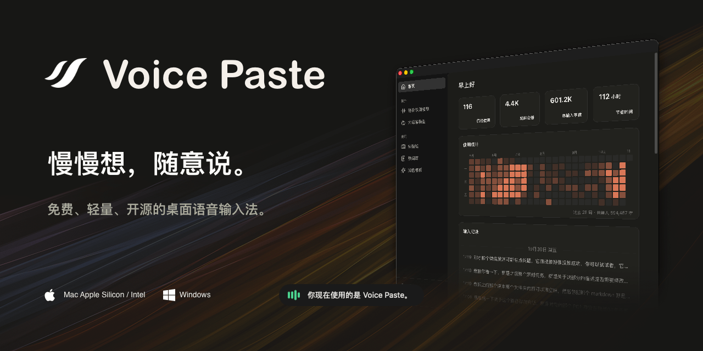
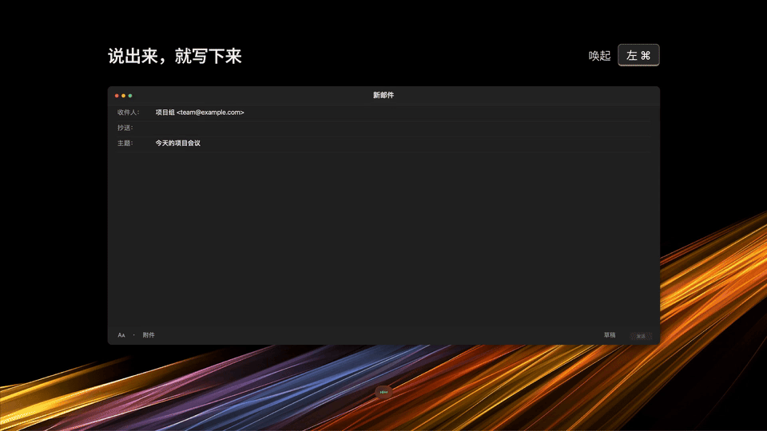

# VoicePaste

VoicePaste 是一款免费、开源、轻量的语音输入法，支持 macOS 和 Windows。

**[下载](https://voicepaste.dev/zh/downloads)** · **[快速开始](https://voicepaste.dev/zh/docs)**

**[中文](README.zh.md)** | **[English](README.md)**

## 效果演示

## 功能特性

- **免费开源**：采用 MIT 协议。在线服务使用你自己的 API Key，费用直接支付给服务商，价格和用量清晰可查。
- **轻量运行**：安装包约 20 MB，macOS 空闲时内存占用约 120 MB。识别模型按需加载，使用时的内存占用因模型和运行方式而异。
- **在线与本地识别**：支持豆包、ElevenLabs 等在线服务，也可以下载本地模型离线识别，无需申请 API Key，音频留在本机。
- **灵活的快捷键与模板**：自定义习惯的快捷键。在免提模式下，可以先说出内容，再用模板快捷键选择如何处理：整理成邮件、翻译，或用于其他场景。支持内置模板和自定义提示词。
- **热词库**：添加人名、产品名和专业术语，按场景分组管理，并在识别后还原大小写和特殊格式。
- **录音提示音**：准备就绪和录音结束时都有提示音，让你知道什么时候可以开始说话、什么时候已经结束。提示音可以关闭或自定义。
- **隐私优先**：配置、历史记录和日志保存在本机，不会自动上传。使用在线识别或润色时，音频或文字会发送给你选择的服务商；反馈仅在你主动提交时发送。

## 快速开始

### 下载

前往 [GitHub Releases](https://github.com/that-yolanda/voicepaste/releases/latest) 或 [官网下载页面](https://voicepaste.dev/downloads)，下载适合你电脑的最新版本。

| 平台 | 安装包文件名 |
| --- | --- |
| macOS（Apple Silicon） | `VoicePaste_{version}_aarch64.dmg` |
| macOS（Intel） | `VoicePaste_{version}_x64.dmg` |
| Windows（x64） | `VoicePaste_{version}_x64-setup.exe` / `.msi` |

macOS 安装包经过 Apple 签名与公证；Windows 安装包暂未签名，安装提示的处理方法见 [常见问题](https://voicepaste.dev/docs/faq#windows-install)。

权限、模型配置和首次输入，请参阅官网的 [快速开始](https://voicepaste.dev/zh/docs)。

## 支持模型

### 在线语音识别

| 模型与配置教程 | 支持语言 | 流式输出 | 热词 |
| --- | --- | --- | --- |
| [豆包流式语音识别 2.0](https://voicepaste.dev/docs/api/volcengine) | 中英混说；方言支持随接口模式而异 | 原生支持 | 支持 |
| [ElevenLabs — Scribe v2 Realtime](https://voicepaste.dev/docs/api/elevenlabs) | 多语言，自动识别语言 | 原生支持 | 需在模型设置中开启热词功能 |

在线识别需要联网，并填写自己申请的 API 凭证。费用与可用额度以服务商为准。

### 本地语音识别

| 模型 | 支持语言 | 模型大小 | 峰值内存 | 实时输出 | 原生热词 |
| --- | --- | --- | --- | --- | --- |
| SenseVoice INT8 | 中英日韩粤 | 158 MB | ~580 MB | 分段输出 | 不支持 |
| Zipformer 中英双语 | 中英双语 | 150 MB | ~465 MB | 原生流式 | 支持 |
| Zipformer 中文 INT8 | 中文 | 160 MB | - | 原生流式 | 支持 |
| FunASR-Nano INT8 | 中英日，中文方言 | 948 MB | ~2.5 GB | 分段输出 | 支持 |
| Qwen3-ASR 0.6B INT8 | 多语言，中文方言 | 938 MB | - | 分段输出 | 支持 |

- 本地识别基于 sherpa-onnx，支持的 CPU / CUDA / CoreML 加速方式因模型而异。
- 分段输出通过语音活动检测（VAD）将录音分段，在录音过程中逐段识别并显示文字。
- 不支持原生热词的模型，也可以在润色时借助大语言模型处理热词；热词替换可还原保存时的拼写与格式。标点和数字的处理方式因模型与设置而异。
- 内存数据基于 Mac mini（Apple Silicon）本地实测，按活动监视器中 VoicePaste 相关进程组统计；系统负载、内存压缩、推理后端和缓存状态均可能影响结果。豆包在线识别实测约 150 MB，详见 [性能测试报告](docs/tests/performance-report.md)。

各模型支持哪些功能，可查看 [模型兼容清单](https://voicepaste.dev/docs/compatibility)，下载与配置见 [识别模型指南](https://voicepaste.dev/docs/models)。

### 大语言模型

DeepSeek · OpenAI · Anthropic · Gemini · OpenRouter · SiliconFlow · Ollama · OpenAI 兼容服务

大语言模型用于润色和翻译，普通语音输入无需配置。

## 文档

- [使用文档](https://voicepaste.dev/docs)
- [常见问题](https://voicepaste.dev/docs/faq)
- [提交反馈](https://voicepaste.dev/feedback)
- [开发说明](docs/development.zh.md)
- [更新说明](CHANGELOG.zh.md)

## License

[MIT](LICENSE)
